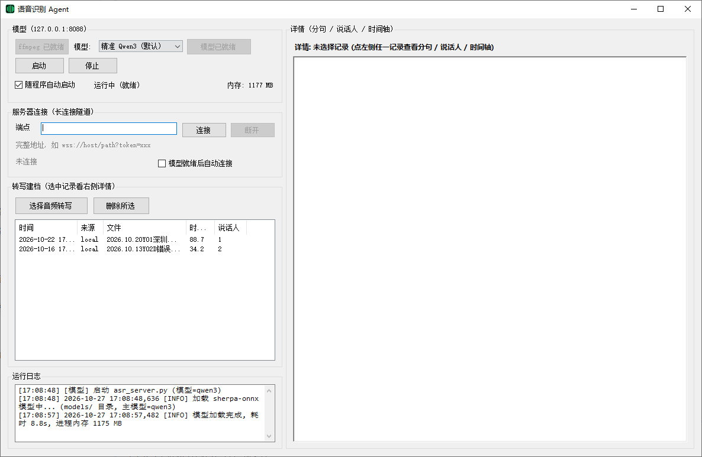

# AsrNode — 本地中文语音识别 绿色免安装版

> Windows 10 / 11 64 位 · 绿色免安装。只要单个 exe 就下载 `AsrNode-lite.exe`（首次运行自动拉取运行环境）；
> 想完全离线开箱即用，下载 `AsrNode-core.zip` 解压后双击 `AsrAgent.exe`。都无需安装 Python 与 ffmpeg。

<div align="center">
  
</div>

Windows 桌面端语音识别节点：WinForms 外壳（`AsrAgent.exe`）+ 内嵌 Python 服务（FastAPI + sherpa-onnx，INT8 CPU 推理），
通过 WSS 隧道接入公网网关，接收 `transcribe` 指令并把转写结果写回本地档案。

## 两种下载方式

| 下载 | 体积 | 说明 |
| --- | --- | --- |
| `AsrNode-lite.exe` | 约 28 KB | **极简版**，就一个 exe。放到任意空目录双击运行，首次自动下载运行环境（约 64 MB）并解压，之后每次启动都不再联网 |
| `AsrNode-core.zip` | 约 64 MB | **完整包**，解压即用，首次启动无需联网 |

两者装好后的程序和功能完全一样，用哪个都行。

## 快速开始（普通用户）

**极简版**：把 `AsrNode-lite.exe` 放进一个空文件夹（例如 `D:\AsrNode`），双击运行，点"开始下载并安装"，
等待下载 + 解压完成会自动启动主程序。首次需要联网，之后直接双击即可离线使用。

**完整包**：
1. 到 Releases 下载 `AsrNode-core.zip`，解压到任意目录（路径不要含特殊字符）。
2. 双击 `AsrAgent.exe`。
3. 首次使用点"下载基础包"，安装 ffmpeg（约 84 MB，装好后按钮变灰显示"ffmpeg 已就绪"）。
4. 在"识别模型"下拉框选择模型；本地没有时右侧会出现"下载"按钮，点击后进度写入日志，下载并校验（sha256）完成后自动加载。
5. 填入服务器端点（如 `wss://host/path?token=xxx`），点"连接"。
6. 左侧列表选一条记录，右侧查看按"分句 / 说话人 / 时间轴"排版的全文。

要求：Windows 10/11 64 位。

> 极简版提示"下载失败"时，可先手动下载 `AsrNode-core.zip` 解压到同一目录，再双击 `AsrNode-lite.exe`（检测到已安装会直接启动）。
> 下载中断可以直接点"重试"，会从断点续传。

### 三种模型

| 模型 | 说明 | 体积 |
| --- | --- | --- |
| 精准 Qwen3-ASR-0.6B | 默认，识别质量最好 | 约 980 MB |
| 快速 SenseVoice-Small | 速度最快，适合长音频 | 约 240 MB |
| 经典 Paraformer-zh | 自带标点模型 | 约 540 MB |

主包只带 VAD 与说话人分离模型，其余按需从 Release 资源下载；下载会自动测速选源（GitHub 直连 / 镜像），支持断点续传与 sha256 校验。

## 从源码构建

```powershell
cd src
powershell -NoProfile -ExecutionPolicy Bypass -File build_release.ps1 `
  -Owner xinghuoseo -Repo asr-node -Tag v1.0.0
```

便携 Python 会依次从 `-PyEmbedDir`、本机缓存 `runtime\pyembed\`、上次构建产物中查找，都没有时自动下载可嵌入版。

脚本会编译 `AsrAgent.exe`、组装便携 Python 运行时（可嵌入版 + site-packages）、打包 VAD/说话人分离模型，
再生成按需下载资源包并回填 `models.json` 的下载地址 / 大小 / sha256：

```
dist\AsrNode-core.zip            主包（解压双击即用）
dist\assets\ffmpeg.zip           基础包      -> tools\ffmpeg.exe
dist\assets\model-qwen3.zip      精准模型    -> models\qwen3\*
dist\assets\model-sensevoice.zip 快速模型    -> models\sensevoice\*
dist\assets\model-paraformer.zip 经典模型    -> models\paraformer\* + models\punc\*
dist\AsrNode\                    未压缩主包（可直接运行调试）
```

## 目录结构

```
src\        Agent.cs（WinForms 外壳）Lite.cs（极简版引导器）asr_server.py（本地推理服务）build_release.ps1 models.json（下载清单模板）
runtime\    开发机运行目录：.venv\ + models\ + agent_config.json + records.json
data\       音频素材
dist\       出包产物（已忽略）
```

## 说明

- 整个目录可整体搬迁：程序内路径均基于 exe 所在目录与 `asr_server.py` 所在目录解析。
- `agent_config.json` 保存服务器地址与 token，`records.json` 保存转写档案，均为本机文件，已在 `.gitignore` 中排除。
- 本地服务监听 `0.0.0.0:38088`（局域网可访问），接口 `/health`、`/transcribe`、`/transcribe_b64`、`/shutdown`（`/shutdown` 仅本机可调用）。局域网调用说明见 [局域网API调用文档](docs/局域网API调用文档.md)。
